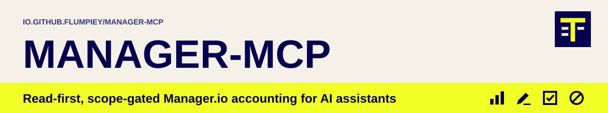

<picture>
  <source media="(prefers-color-scheme: dark)" srcset="https://raw.githubusercontent.com/flumpiey/manager-mcp/main/assets/banner-dark.svg">
  
</picture>

<!-- mcp-name: io.github.flumpiey/manager-mcp -->

[](LICENSE)
[](https://github.com/flumpiey/manager-mcp/actions/workflows/ci.yml)
[](pyproject.toml)
[](https://pypi.org/project/manager-mcp/)

## What it is and why

`manager-mcp` is a stdio [Model Context Protocol](https://modelcontextprotocol.io/) server for [Manager.io](https://www.manager.io/), the self-hosted accounting package. It lets Claude, Cursor, VS Code Copilot and other MCP hosts answer questions such as "who owes me money?" against your live books. AI write access to a ledger is risky, so the server starts read-only and adds write tools only for the domains you name.

## Features

- **Read-only by default.** With no scopes set, the server registers 10 read tools and nothing that can change data.
- **Scoped writes.** `MANAGER_MCP_WRITE_SCOPES` and `MANAGER_MCP_DELETE_SCOPES` take a comma-separated list of domains. Delete is never implied by write.
- **Task tools.** Intent-shaped writes such as `record_customer_payment` (receipt plus invoice allocation) instead of raw form posts.
- **Hard denylist.** Access tokens, chart of accounts forms, tax codes, currencies, exchange rates, starting balances, bank reconciliation, custom field definitions, themes and email settings stay blocked even with writes on.
- **Fail-loud configuration.** Unknown scopes, wildcards (`*`, `all`) and the legacy `MANAGER_MCP_ALLOW_WRITES` style variables stop the server at start-up.
- **Customer deposit workflow.** Deposits post to a deposit bank or cash account, never to income. The server looks for an account named exactly "Customer deposits", or you pass `bank_account`. A missing account returns `precondition_failed` with setup steps.
- **Packaged for hosts.** PyPI package for `uvx`, a Claude Desktop extension (`.mcpb`), a Cursor plugin and an entry in the MCP Registry as `io.github.flumpiey/manager-mcp`.
- **Companion agent skill.** [`skills/manager-accounting/SKILL.md`](skills/manager-accounting/SKILL.md) tells the model to call `list_resources` first and to verify after writes.

## Quick start

Requirements: [uv](https://docs.astral.sh/uv/) and a reachable Manager.io API. In Manager, open **Settings > Access Tokens**, create a token, and note your API base URL (include `/api2`).

```bash
export MANAGER_API_URL="http://<manager-host>:<port>/api2"
export MANAGER_API_KEY="<access-token>"
uvx manager-mcp
```

The server speaks MCP over stdio, so a host normally starts it for you. Add it to Claude Code:

```bash
claude mcp add manager --env MANAGER_API_URL=http://<manager-host>:<port>/api2 --env MANAGER_API_KEY=<access-token> -- uvx manager-mcp
```

Most other hosts take the same JSON block:

```json
{
  "mcpServers": {
    "manager": {
      "command": "uvx",
      "args": ["manager-mcp"],
      "env": {
        "MANAGER_API_URL": "http://<manager-host>:<port>/api2",
        "MANAGER_API_KEY": "<access-token>"
      }
    }
  }
}
```

| Host | Config file | Top-level key |
| --- | --- | --- |
| Claude Desktop (macOS) | `~/Library/Application Support/Claude/claude_desktop_config.json` | `mcpServers` |
| Claude Desktop (Windows) | `%APPDATA%\Claude\claude_desktop_config.json` | `mcpServers` |
| Cursor | `.cursor/mcp.json` or `~/.cursor/mcp.json` | `mcpServers` |
| VS Code / Copilot | `.vscode/mcp.json` (add `"type": "stdio"`) | `servers` |
| Windsurf | `~/.codeium/windsurf/mcp_config.json` | `mcpServers` |
| Zed | `settings.json` | `context_servers` |
| Cline | `cline_mcp_settings.json` | `mcpServers` |

Restart the host after you save, then ask "show bank balances".

<details>
<summary><strong>Claude Desktop extension (.mcpb)</strong></summary>

1. Download [`mcpb.mcpb`](https://github.com/flumpiey/manager-mcp/releases/latest/download/mcpb.mcpb) from the latest release (v0.2.6 or later).
2. In Claude Desktop, open **Settings > Extensions > Advanced settings > Install Extension...** and select the file.
3. Enter **Manager API URL** and **Manager API key**. Leave **Write scopes** and **Delete scopes** empty for read-only.

On Windows, a double-click or a drag into chat does not install the file. Use **Install Extension...** instead. To build the bundle from a clone: `npx @anthropic-ai/mcpb pack mcpb`.

</details>

<details>
<summary><strong>Cursor plugin</strong></summary>

This repo is a Cursor plugin through [`.cursor-plugin/plugin.json`](.cursor-plugin/plugin.json) and the root [`mcp.json`](mcp.json). Copy or symlink the clone to `~/.cursor/plugins/local/manager-mcp`, reload the window, then open **Plugins > Configure** to set the URL, key and scopes. The plugin also loads the `skills/` folder.

</details>

<details>
<summary><strong>Continue</strong></summary>

```yaml
mcpServers:
  - name: manager
    command: uvx
    args:
      - manager-mcp
    env:
      MANAGER_API_URL: http://<manager-host>:<port>/api2
      MANAGER_API_KEY: <access-token>
```

</details>

## Configuration

| Name | Required | Default | Purpose |
| --- | --- | --- | --- |
| `MANAGER_API_URL` | yes | none | Manager API base URL, including `/api2` when your instance needs it. |
| `MANAGER_API_KEY` | yes | none | Access token, sent as the `X-API-KEY` header. |
| `MANAGER_MCP_WRITE_SCOPES` | no | empty (read-only) | Comma-separated domains that get create and update tools. |
| `MANAGER_MCP_DELETE_SCOPES` | no | empty | Comma-separated domains that get delete tools and `void_document`. |
| `MANAGER_UI_USERNAME` | for attachments | none | Manager user for the attachment upload route, which ignores the API key. Use a dedicated least-privilege user. |
| `MANAGER_UI_PASSWORD` | for attachments | none | Password for `MANAGER_UI_USERNAME`. |
| `TEST_MANAGER_API_URL` | integration tests only | none | Sandbox business URL for `pytest -m integration`. |
| `TEST_MANAGER_API_KEY` | integration tests only | none | Sandbox business token for `pytest -m integration`. |

Valid scopes: `quotes`, `orders`, `parties`, `items`, `sales`, `purchases`, `banking`, `payroll`, `ledger`, `automation`, `raw`. Setting `MANAGER_MCP_ALLOW_WRITES`, `ALLOW_WRITES` or `MANAGER_MCP_WRITES` stops the server with an error. See [`.env.example`](.env.example).

A narrow set covers most bookkeeping:

```json
"MANAGER_MCP_WRITE_SCOPES": "banking,sales,parties",
"MANAGER_MCP_DELETE_SCOPES": "sales,banking"
```

## Tools

The server registers 10 tools with no scopes, 80 with every domain scope on, and 98 with `raw`.

### Read tools (always on)

| Tool | Access | What it does |
| --- | --- | --- |
| `list_resources` | read | Lists curated capabilities, the read-only flag and the live write and delete scopes. |
| `list_records` | read | Searches and pages a collection: `customers`, `suppliers`, `sales_invoices`, `purchase_invoices`, `chart_of_accounts`, `divisions`, `bank_accounts`. `divisions` is read-only setup data that resolves a transaction line's `Division` key. |
| `get_record` | read | Fetches one record by key through its form endpoint. `chart_of_accounts` is list only. |
| `aged_receivables` | read | Outstanding customer balances. |
| `aged_payables` | read | Outstanding supplier balances. |
| `bank_balances` | read | Bank and cash balance snapshot. |
| `trial_balance` | read | Trial balance for an optional `from_date` / `to_date`. |
| `profit_and_loss` | read | Profit and loss for an optional period. |
| `balance_sheet` | read | Balance sheet for an optional period. |
| `tax_summary` | read | Tax summary snapshot. |

### Task tools (opt-in)

| Tool | Access | Registers when | What it does |
| --- | --- | --- | --- |
| `issue_sales_invoice` | write | `sales` | Issues a sales invoice with inline lines. |
| `issue_purchase_invoice` | write | `purchases` | Issues a purchase invoice. |
| `issue_quote` | write | `quotes` | Issues a sales quote, or a purchase quote with `purchase=true`. |
| `issue_deposit_invoice` | write | `quotes` | Issues a sales quote styled as a deposit document (not revenue). |
| `convert_quote_to_invoice` | write | `quotes` and `sales` | Converts a sales quote to a sales invoice. |
| `record_customer_payment` | write | `banking` | Records a receipt and allocates it to an open sales invoice. |
| `record_supplier_payment` | write | `banking` | Records a payment allocated to a purchase invoice. |
| `record_customer_deposit` | write | `banking` | Records money received before an invoice exists, into a deposit account. |
| `transfer_between_accounts` | write | `banking` | Moves money between bank or cash accounts. |
| `record_expense` | write | `payroll` or `purchases` | Records an expense as an expense claim or a purchase invoice. |
| `post_journal_entry` | write | `ledger` | Posts a generic journal entry. |
| `apply_deposit_to_invoice` | write | `ledger` | Applies a held deposit to a sales invoice through a journal entry. |
| `attach_receipt_to_purchase_invoice` | write | `purchases` | Attaches a file (base64, max 10 MB) to a purchase invoice's Attachments list. Needs a Manager user login. Returns `unverified`, because Manager cannot list attachments over its API. |
| `void_document` | delete | any delete scope | Deletes a document by resource name and key; needs that resource's delete scope. |
| `create_customer`, `update_customer`, `create_supplier`, `update_supplier` | write | `parties` | Creates or updates a customer or supplier. |
| `delete_customer`, `delete_supplier` | delete | `parties` (delete) | Deletes a customer or supplier. |

### Per-resource CRUD tools

Each enabled scope also registers `create_*` and `update_*` (write) and `delete_*` (delete) for its resources. For documents that task tools cover, `create_*` and `delete_*` register only with the `raw` scope; use the task tools and `void_document`. These are sales and purchase invoices, quotes, receipts, payments, inter-account transfers, journal entries and expense claims. `update_*` registers for every resource.

| Scope | Resources |
| --- | --- |
| `quotes` | sales_quotes, purchase_quotes |
| `orders` | sales_orders, purchase_orders |
| `items` | inventory_items, non_inventory_items |
| `sales` | sales_invoices, credit_notes, delivery_notes |
| `purchases` | purchase_invoices, debit_notes, goods_receipts |
| `banking` | receipts, payments, inter_account_transfers, bank_accounts |
| `payroll` | employees, payslips, expense_claims |
| `ledger` | journal_entries, depreciation_entries, amortization_entries |
| `automation` | custom_buttons |

### Permission and safety model

1. **Registration gate.** A write tool exists only when its scope is in `MANAGER_MCP_WRITE_SCOPES`. A delete tool exists only when its scope is in `MANAGER_MCP_DELETE_SCOPES`.
2. **Request gate.** The HTTP client checks every `POST`, `PUT`, `PATCH` and `DELETE` against the scope map again before it sends the request. An unmapped path is refused.
3. **Denylist.** Paths for access tokens, chart of accounts and other `*-account-form` paths (except bank or cash accounts), bank reconciliation, customer portal, starting balances, tax codes, exchange rates, currencies, custom fields, themes and email templates or settings are refused for every scope, `raw` included.
4. **Automation gate.** Custom button paths need `automation` in the matching scope, because a button can call external systems.
5. **`raw` escape hatch.** `raw` expands to every domain scope and restores `create_*` and `delete_*` for task-covered documents. Use it only when you need the full CRUD set.

A deposit is not revenue. Confirm tax and VAT treatment of deposits with your accountant.

## Development

```bash
git clone https://github.com/flumpiey/manager-mcp.git
cd manager-mcp
uv sync --extra dev
uv run ruff check src tests
uv run pytest
uv build
```

`uv run pytest` runs the offline suite (respx mocks, no live Manager). Run `uv run pytest -m integration` with `TEST_MANAGER_API_URL` and `TEST_MANAGER_API_KEY` set against a sandbox business. CI runs ruff and pytest on Python 3.10 and 3.12. Run the server from the clone with `uv run manager-mcp`.

Limits:

- One process serves one `MANAGER_API_URL`.
- Attachments use an internal Manager route, confirmed on 26.8.4.3664 and 26.8.27.0. A Manager update can break it, and uploads cannot be read back over the API.
- Multi-business disambiguation on a shared host is unverified.
- The vendored `src/manager_mcp/spec/api2.json` is provenance only; the server always calls the live API.
- Transport is stdio only, so hosts that need a hosted HTTP endpoint cannot use it.

## Licence

MIT. See [LICENSE](LICENSE).

---

Built by Dru Connold. [flumpiey.github.io](https://flumpiey.github.io) / [malvadev.com](https://malvadev.com)
